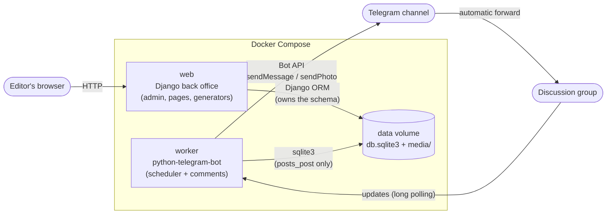
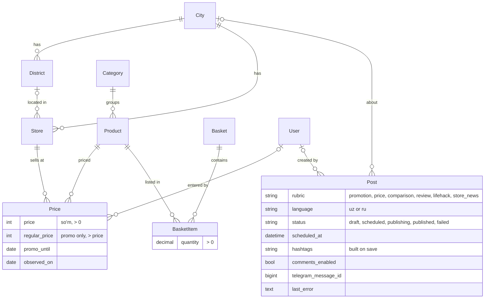
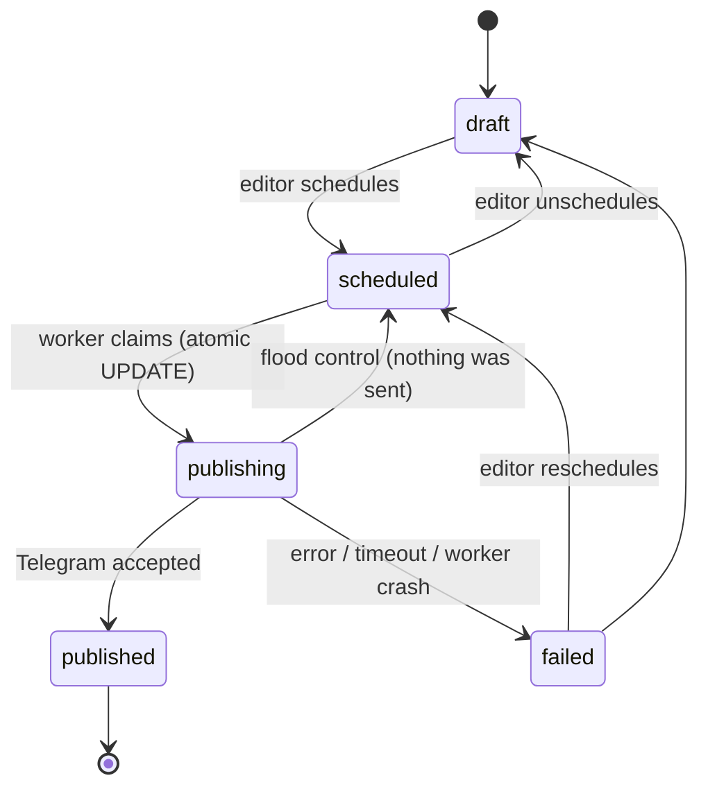

# Regional Price & Deals — Fergana Valley Channel Platform

Course project (CS Python, TTPU 2026-27).

A Django-managed Telegram channel platform for the Fergana Valley region
(Qo'qon, Farg'ona, Andijon, Namangan, Marg'ilon). It helps subscribers save
money with promotions, price tracking, price comparison, product reviews,
life hacks, and store news.

Editors record prices in a small back office. The platform compares stores
and baskets, writes channel posts in Uzbek or Russian, and a Telegram bot
worker publishes the scheduled posts to the channel.

**Status:** Complete (Parts 1–30).

## Features
- **Locations and catalog:** cities, districts, stores, categories and
  products, managed in the back office and in the Django admin.
- **Price history:** an append-only `Price` table (each row is one price of a
  product in a store on a day). Promotions are prices that have a regular
  price and an optional end date.
- **Fast daily price entry:** pick a store and a day, then type the prices
  of all products on one page. Enter jumps to the next product and the last
  known price is shown.
- **Product page:** the current price in every store, with the cheapest one
  highlighted, the price per kg/litre, and a Chart.js price history over 30,
  90 or 365 days.
- **Baskets:** a shopping list compared across stores. Stores that miss
  products get an estimated total and are ranked after complete ones.
- **Posts:** rubric, language, optional photo, city, hashtags, schedule and
  comments on/off. The editor shows a live Telegram-style preview and
  enforces Telegram's length limits.
- **Generators:** create a draft post from a promotion, a product's prices,
  a basket comparison or a new store.
- **Dashboard:** counts, upcoming posts, recent failures, and stores without
  fresh prices.
- **Worker:** publishes due posts, never sends a post twice, and can switch
  comments off for a single post.
- **i18n:** the site and the posts are in Uzbek by default, with Russian as
  the second language.

## Stack
- Python 3.12, Django 5.2, Pillow
- SQLite (one file on a shared Docker volume)
- python-telegram-bot 21.x
- Chart.js 4 (from a CDN, product page only)
- Docker Compose (web + worker services)

## Setup
Requirements: Docker with Docker Compose. To publish, you also need a
Telegram bot token from [@BotFather](https://t.me/BotFather) and a channel
where the bot is an administrator.

1. Create your local settings file:
   ```bash
   cp .env.example .env
   ```
   Fill in `TELEGRAM_BOT_TOKEN` and `TELEGRAM_CHANNEL_ID` (`@channel_name` or
   `-100…`). For per-post comment switching, also fill in
   `TELEGRAM_DISCUSSION_GROUP_ID`; see [Comments](#comments).
2. Build and start both services:
   ```bash
   docker compose up --build
   ```
3. Create an admin user, then load the demo data (5 cities, 14 stores,
   24 products, 60 days of prices with promotions):
   ```bash
   docker compose exec web python manage.py createsuperuser
   docker compose exec web python manage.py seed_demo
   ```
4. Open http://localhost:8000/ and log in. In Telegram, send `/start`,
   `/ping` or `/status` to the bot.

Without a bot token the worker stops with an error message in its log. The
web app works without it.

Useful commands:
```bash
docker compose exec web python manage.py test        # web tests
docker compose run --rm worker python -m unittest discover -s tests -t .   # worker tests
docker compose logs -f worker                        # follow the bot logs
docker compose down                                  # stop (add -v to delete the database)
```

### Environment variables
| Variable | Service | Purpose |
|---|---|---|
| `DJANGO_SECRET_KEY`, `DJANGO_DEBUG`, `DJANGO_ALLOWED_HOSTS` | web | Django settings |
| `DATABASE_PATH` | both | SQLite file, `/data/db.sqlite3` in Docker |
| `MEDIA_ROOT` | both | uploaded post photos, `/data/media` in Docker |
| `TELEGRAM_BOT_TOKEN` | worker | bot token from @BotFather |
| `TELEGRAM_CHANNEL_ID` | worker | channel the posts are published to |
| `TELEGRAM_DISCUSSION_GROUP_ID` | worker | optional: linked discussion group |
| `SCHEDULER_INTERVAL_SECONDS` | worker | how often due posts are checked (default 30) |

## Using the platform
1. **Enter prices** (menu → *Narx kiritish*): choose a store and a day,
   type the prices you saw and save. For a promotion, also fill in the
   regular price and the end date.
2. **Compare:** open a product to see its cheapest store and price history,
   or build a basket under *Savatlar* to rank the stores by its total.
3. **Write or generate a post** under *Postlar*. Check the preview, untick
   *comments* if needed, then click **Save and schedule**. If you leave the
   time empty, the post goes out on the worker's next check.
4. **Watch** the dashboard for upcoming posts and failures. A failed post
   shows the reason and can be fixed and scheduled again.

## Architecture



- **web** (`web/`) is the Django project. It applies migrations on start
  and serves the back office on port 8000. The apps are:
  - `locations` (cities, districts, stores)
  - `catalog` (categories, products, prices, price entry, product page)
  - `baskets` (baskets and the comparison logic)
  - `posts` (posts, hashtags, the editor, generators and Telegram formatting)
  - `core` (dashboard, login, `seed_demo`, shared helpers)
- **worker** (`worker/`) is the bot, with no Django inside:
  - `bot.py` is the entry point and commands
  - `scheduler.py` is the publishing loop
  - `publisher.py` handles message format, limits and Telegram errors
  - `comments.py` switches comments off per post
  - `db.py` is plain SQL on the shared database
- The two services share **one SQLite file**. Django owns the schema. The
  worker only reads posts and updates their publishing fields
  (`db.POST_COLUMNS`). A web test (`posts/tests_worker_schema.py`) fails if
  a migration removes a column the worker needs.

### Data model



The database enforces these rules (not only the forms):
- a price is positive, and a regular price is above the price;
- a product name, brand and size combination is unique;
- a store name and address are unique within the city;
- a basket lists each product only once;
- a scheduled post has a publication time.

Deleting a city, store or category that still has data is blocked
(`PROTECT`).

**The "current price"** of a product in a store is the newest `Price` row.
Rows are never edited, and a correction is a new row. Once a promotion has
ended, the product counts at its regular price (`Price.effective_price`).

### Post life cycle and the no-double-publish rule



1. Every `SCHEDULER_INTERVAL_SECONDS`, the worker selects the posts with
   `status = 'scheduled' AND scheduled_at <= now`.
2. It claims each post with
   `UPDATE … SET status='publishing' WHERE id=? AND status='scheduled'`.
   SQLite performs one write at a time, so only one worker, or one pass of
   the loop, can claim a given post. The others see `rowcount = 0` and skip
   it.
3. The result is written only if the post is still `publishing`.
4. A post is never retried after an unknown outcome. Telegram may have
   posted a message even when the request timed out. So timeouts, network
   errors and posts stuck in `publishing` after a crash (10 minutes) become
   `failed`, with a note to check the channel. Only flood control
   (`RetryAfter`), where Telegram says nothing was sent, puts the post back
   in the queue.

### Message format and limits
The editor's text is plain text. It is HTML-escaped and sent with
`parse_mode=HTML` as `<b>title</b>`, then the body, then the hashtags.

Lengths are counted the way Telegram counts them: UTF-16 code units, after
the HTML is parsed. The limits are 4096 for a text message and 1024 for a
photo caption. The editor rejects longer posts, and the worker checks the
limits again before sending.

Hashtags are built from:
1. the rubric, in the post's language;
2. the city;
3. the editor's extra tags.

Uzbek apostrophes are removed, so `Qo'qon` becomes `#Qoqon`. Without this,
Telegram would end the tag at the apostrophe.

### Comments
When a channel has a linked discussion group, Telegram copies each new
channel post into that group, and the comments are replies to that copy.
If the editor unticks **comments** on a post, the worker deletes that copy
in the group, which removes the comment thread for that post only.

To set this up:
1. Link a discussion group to the channel.
2. Make the bot an administrator of the group with *Delete messages*.
3. Set `TELEGRAM_DISCUSSION_GROUP_ID`.

### Languages
- `LANGUAGE_CODE = "uz"`, `LANGUAGES = uz, ru`. The language switcher is in
  the top bar.
- Translations live in `web/locale/{uz,ru}/LC_MESSAGES/`. The compiled
  `.mo` files are committed, so the image does not need gettext.
- The generator templates (`web/posts/templates/posts/generators/*.txt`)
  are rendered in the post's language, not the editor's.

To update the translations (needs GNU gettext):
```bash
cd web && python manage.py makemessages -l uz -l ru && python manage.py compilemessages
```

## Project structure
```
docker-compose.yml   web + worker services and the shared "data" volume
.env.example         template for the local .env file
web/
  config/            settings, URLs
  core/              dashboard, login, permissions, seed_demo, base templates and CSS
  locations/         City, District, Store + store pages
  catalog/           Category, Product, Price + product pages, price entry, chart data
  baskets/           Basket, BasketItem + comparison logic and pages
  posts/             Post, hashtags, editor and preview, generators, Telegram formatting
  locale/            uz and ru translations
worker/
  bot.py             entry point: commands, scheduler start, comments handler
  scheduler.py       due-post loop and status changes
  publisher.py       message building, limits, Telegram error handling
  comments.py        comments on/off through the discussion group
  db.py              SQL on the shared database
  tests/             worker unit tests (unittest)
```

## Tests
- **web:** 111 Django tests (98% line coverage). They cover models and
  constraints, permissions, every page and form, price history, basket
  ranking, hashtags, length limits, i18n, generators, admin, and the
  worker-schema check.
- **worker:** 39 unittest tests (94% line coverage). They cover due-post
  selection, the atomic claim with two connections, stale recovery,
  publishing (photo or text, limits, escaping, every Telegram error),
  comments, and the bot commands.

The final check was a fresh clone run with `cp .env.example .env` and
`docker compose up --build`. In that run:
- the web service became healthy and served the pages and static files;
- the migrations, `seed_demo` and all tests passed inside the containers;
- a post scheduled in Django was claimed and marked published by the
  worker loop on the shared volume.

## Limitations
- **SQLite** suits one small team. Many editors writing at the same time
  would need PostgreSQL. The worker's claim would then also need
  `SELECT … FOR UPDATE SKIP LOCKED` or the same conditional `UPDATE`.
- **Development server:** the web service runs `manage.py runserver`, which
  also serves the static files and photos only while `DJANGO_DEBUG=1`.
  Production would need gunicorn, `collectstatic` and a web server for
  `/static` and `/media`.
- **Translations:** only the navigation, login page, dashboard and all
  channel post texts are translated. The other back-office pages are still
  in English.
- **Editing published posts:** a published post is not edited or deleted in
  Telegram when it changes in the back office. The worker only sends new
  messages.
- **Message format:** one photo per post, no albums, buttons or polls.
  Formatting is limited to the bold title, because the editor's text is
  escaped.
- **Charts:** the chart shows prices as they were recorded. When a
  promotion ends, its line returns to the regular price only once a new
  price is entered.
- **Comments:** comments can only be switched off at publication time, and
  only if the bot is an administrator of the linked group. Switching them
  on or off later is not supported.
- **Chart.js** loads from a CDN, so the product chart needs internet access.

## License
Educational project — TTPU CS 2026-27.
