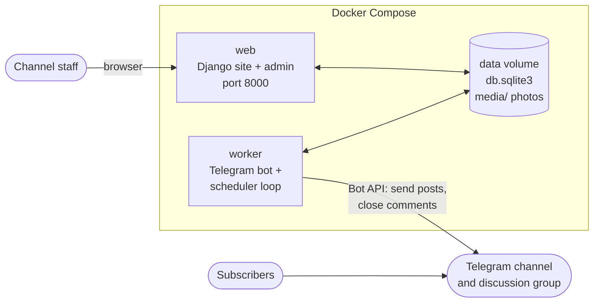
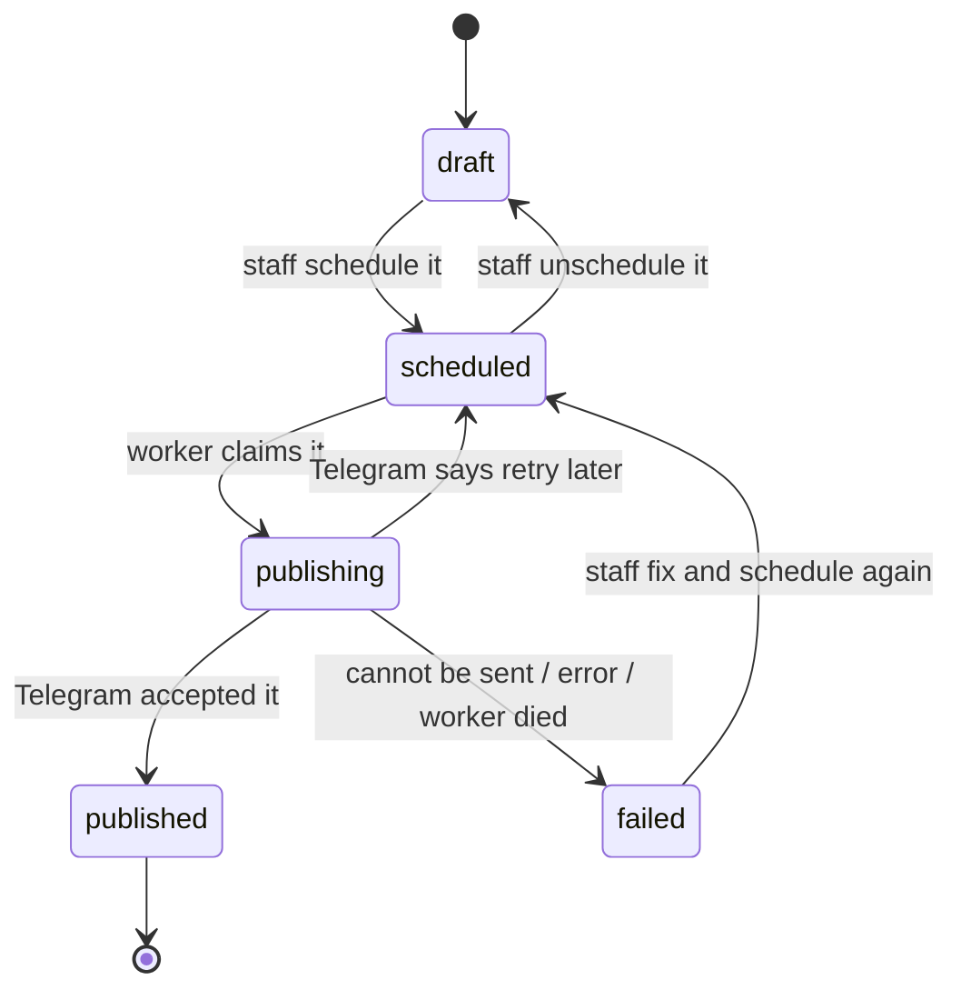
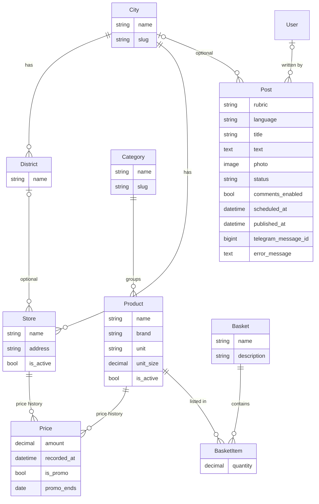

# Regional Price & Deals — Fergana Valley Channel Platform

Course project (CS Python, TTPU 2026-27).

A Django-managed Telegram channel platform for the Fergana Valley region
(Qo'qon, Farg'ona, Andijon, Namangan, Marg'ilon). Channel staff record
prices in local stores; the platform compares them, finds promotions and
the cheapest store for a shopping basket, and publishes posts about it
to a Telegram channel on a schedule.

**Status:** all 30 parts of the plan are implemented.

## Stack
- Python 3.12, Django 5.2
- SQLite on a shared Docker volume
- python-telegram-bot 21
- Chart.js 4 (bundled, no CDN)
- Docker Compose with two services: `web` and `worker`

## Setup
Requirements: Docker with Docker Compose, a Telegram bot token from
[@BotFather](https://t.me/BotFather), and a channel where the bot is an
administrator.

1. Create your local settings file and fill in `TELEGRAM_BOT_TOKEN` and
   `TELEGRAM_CHANNEL_ID`:
   ```bash
   cp .env.example .env
   ```
2. Build and start both services:
   ```bash
   docker compose up --build
   ```
3. Create a staff account:
   ```bash
   docker compose exec web python manage.py createsuperuser
   ```
4. (Optional) Load demo data — cities, stores, products, 30 days of
   prices and a few promotions:
   ```bash
   docker compose exec web python manage.py seed_demo
   ```
5. Open http://localhost:8000/ and log in.

Useful commands:
```bash
docker compose exec web python manage.py test   # run the tests
docker compose logs -f worker                   # follow the worker
docker compose down                             # stop (add -v to delete the database)
```

### Settings (`.env`)

| Variable | Needed | Meaning |
|---|---|---|
| `DJANGO_SECRET_KEY` | yes | Any long random string |
| `DJANGO_DEBUG` | yes | `1` for local use |
| `DJANGO_ALLOWED_HOSTS` | yes | Host names, comma separated |
| `TELEGRAM_BOT_TOKEN` | worker | Token from @BotFather |
| `TELEGRAM_CHANNEL_ID` | worker | `@channelusername` or numeric id |
| `TELEGRAM_DISCUSSION_GROUP_ID` | optional | Linked discussion group, for switching comments off |
| `WORKER_POLL_SECONDS` | optional | How often the worker looks for due posts (default 30) |

The web service runs without the Telegram values. The worker stops with
a message in its log until the token and the channel id are set.

## What staff can do

| Page | URL |
|---|---|
| Dashboard: counts, upcoming posts, recent failures | `/` |
| Enter today's prices for a store | `/prices/entry/` |
| Products: list, search, add, edit | `/products/` |
| Product: current prices and 30-day price chart | `/products/<id>/` |
| Stores: list by city, add, edit | `/stores/` |
| Baskets: compare the cost of a shopping list between stores | `/baskets/` |
| Posts: write, preview, schedule | `/posts/` |
| Generate a post from the data | `/posts/generate/` |
| Admin (all data) | `/admin/` |

Every page except `/health/` and `/login/` needs a staff account.

## Architecture



- **web** is the Django project in `web/`. On start it applies the
  migrations and serves the site. Staff do all their work here.
- **worker** is `worker/bot.py`. It imports the same Django code, so
  models and logic exist only once. Every 30 seconds it publishes the
  scheduled posts whose time has come. Its image is built from the
  repository root because it needs `web/`.
- The two services never talk to each other directly. They share the
  **data volume**: the SQLite file and the uploaded photos. Scheduling a
  post in the site is just a row in the database that the worker finds.
- The worker starts only after the web service is healthy, so the
  database is always migrated first.

### Django apps (`web/`)

| App | Contains |
|---|---|
| `config` | Settings and root URLs |
| `core` | Login, staff-only access, dashboard, `seed_demo` command |
| `locations` | City, District, Store |
| `catalog` | Category, Product, Price; price entry, comparison, history chart |
| `baskets` | Basket, BasketItem; basket comparison |
| `posts` | Post; hashtags, post form and preview, generators, scheduler, publishing, comments |

### How a post reaches the channel

1. Staff write a post, or generate a draft from the data, and schedule it.
   The form shows a preview and refuses a post over the Telegram limit
   (4096 characters, or 1024 with a photo).
2. When the time comes, the worker **claims** the post with one database
   statement that only works while the post is still `scheduled`. If two
   workers run at once, only one of them gets the post, so nothing is
   published twice.
3. The worker builds the message — bold title, text, hashtags, with
   everything staff typed escaped — and sends it as a text message or as
   a photo with a caption.
4. The post becomes `published` (with the Telegram message id) or
   `failed` (with the reason, shown on the dashboard).



## Data model



Rules worth knowing:

- **Price is append-only.** A price change is a new row; rows are never
  edited or deleted (the model, the admin and bulk updates all refuse).
  The current price is the newest row for a product in a store, and the
  older rows are the history shown in the chart.
- **A promotion is a price row** marked `is_promo`, optionally with an
  end date. After the end date it is shown as ended and is not counted
  as the cheapest price or in basket totals.
- **Baskets with missing products:** a store without a price for some
  product of the basket is listed after the complete stores and is not
  ranked, because its total would look cheap only for what is not counted.
- Cities, categories, products and stores that are still in use cannot
  be deleted (the price history would go with them).

## Languages
Uzbek is the default language and Russian is the second one. The
buttons in the top bar switch the site language. Every post has its own
language, and generated posts come from one set of templates
(`web/templates/posts/generators/`) translated through gettext,
including Russian plural forms.

Translations live in `web/locale/<language>/LC_MESSAGES/django.po`.
The compiled `django.mo` files are committed too, so the Docker images
do not need the gettext tools. After editing a `.po` file run
`python manage.py compilemessages` (needs gettext installed).

## Comments on or off
Telegram has no per-post "comments off" switch. Comments exist when the
channel has a linked discussion group: Telegram copies each channel post
into the group, and that copy is the comment thread. For a post saved
with **Allow comments** off, the worker deletes the copy, which removes
the comment button. This needs `TELEGRAM_DISCUSSION_GROUP_ID` and the
bot as an administrator of the group with the right to delete messages.

## Tests
```bash
docker compose exec web python manage.py test
```
About 200 tests cover every line of the Django code: models, forms,
pages, comparison logic, hashtags, generators in both languages, the
scheduler (including two workers at the same moment) and publishing.

## Limitations

- **Never run against real Telegram.** The worker was tested with a fake
  bot object, not with a real token and channel. Sending, flood control
  and closing comments follow the Bot API documentation but have not
  been seen working in a real channel.
- **Development server.** The web service uses Django's `runserver` and
  serves static files and photos itself, which needs `DJANGO_DEBUG=1`.
  A real deployment needs a production server and a static file setup.
- **SQLite.** One file shared by two containers is fine for one channel
  and a few staff, not for heavy parallel use.
- **At most once.** If the worker dies between sending a post and saving
  the result, the post is marked failed rather than sent again, because
  it may already be in the channel. A person has to check and reschedule.
- **Failed posts are not retried automatically**, except when Telegram
  explicitly says "retry later".
- **Scheduling precision** is the poll interval (30 seconds by default).
- **Only part of the site is translated**: navigation, login and the
  dashboard. The other staff pages, form labels and messages are in
  English. Generated posts are fully translated.
- **Generated posts are drafts.** They are never published without a
  person reading them first.
- **Demo data is invented.** Stores and prices from `seed_demo` are not
  real.
- **Product photos, reviews and life hacks** are ordinary hand-written
  posts with a rubric; there is no separate data model for them.
- **No public pages.** The site is for staff only; subscribers see only
  the Telegram channel.
- **One channel** per installation.

## License
Educational project — TTPU CS 2026-27. Chart.js is bundled under the MIT
licence (`web/catalog/static/catalog/vendor/CHART_JS_LICENSE.md`).
